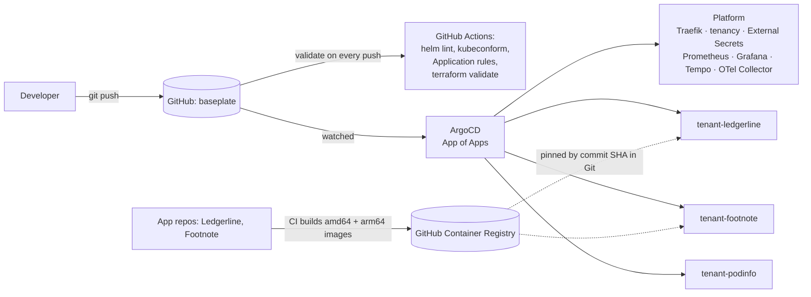
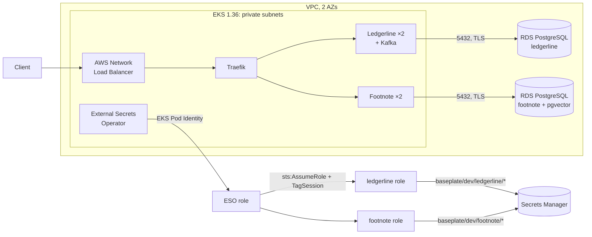
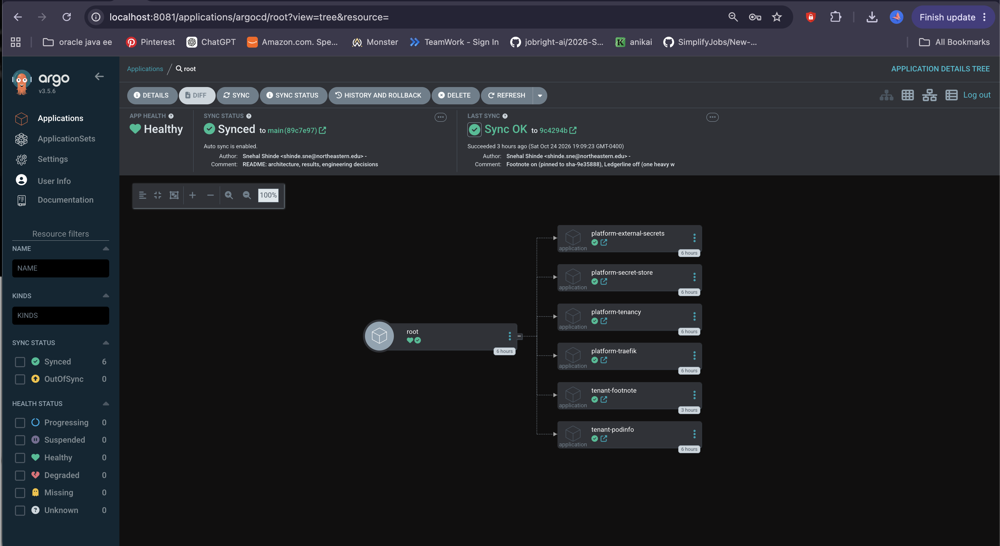
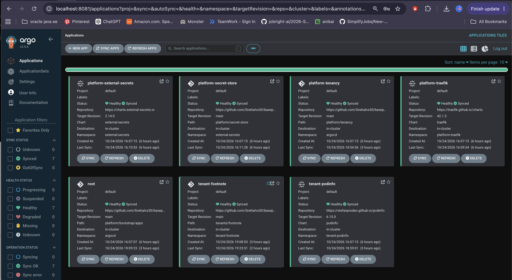
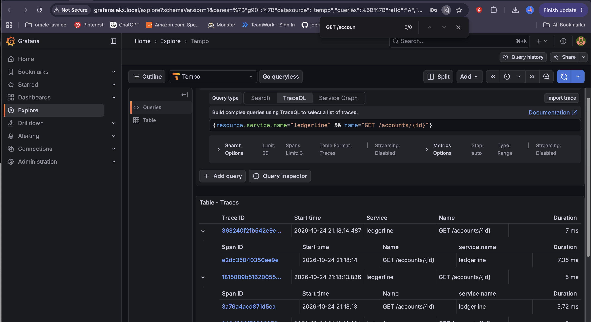
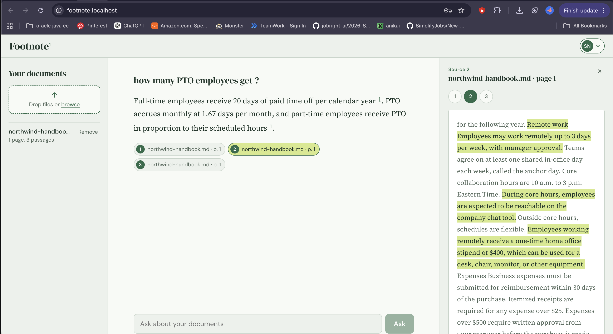
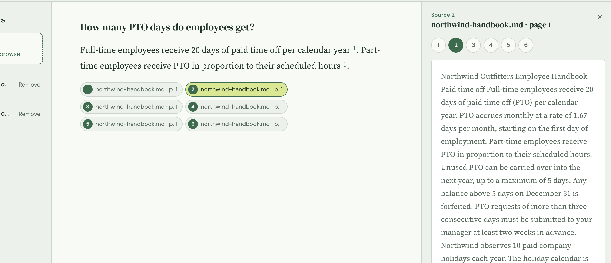
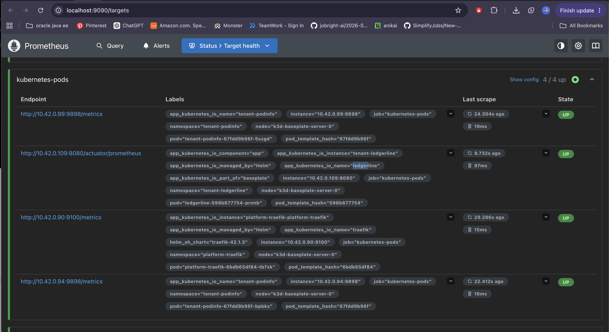

# Baseplate

**A multi-tenant Kubernetes platform, delivered entirely through GitOps.** One Git repository
runs two real applications as isolated tenants, on a laptop (k3s) and on AWS (EKS), with
network isolation, quotas, secrets from AWS Secrets Manager, metrics, traces, and CI that
validates every change before it reaches a cluster.

The tenants are my own projects: **[Ledgerline](https://github.com/Snehalvs30/ledgerline)**, a
payments ledger (Java, Spring Boot, PostgreSQL, Kafka), and
**[Footnote](https://github.com/Snehalvs30/footnote)**, an AI document Q&A app (Python,
FastAPI, React, pgvector).


## Results at a glance

| What was tested | Result |
|---|---|
| Rollout under load on EKS (2 replicas replaced, k6 at 20 requests/s through an AWS NLB) | **4,801 requests, 0 failed** |
| Rollout under load locally, before and after fixing probes and shutdown | **3,650 failed requests (53%) → 0** |
| Drift: a security policy deleted by hand | **Restored from Git in 3 s** |
| Drift: a workload scaled by hand | **Reverted in 2 s** |
| Tenant isolation test suite (network, quota, access) | **11/11 checks pass** |
| A code fix released through GitOps | **One line changed in Git** (Footnote's image tag) |
| Tracing on EKS | Showed **~90% of request latency was network**, not the app (5–7 ms server time vs 55 ms at the client) |

Full numbers and method: [`docs/day8-results.md`](docs/day8-results.md) (local) and
[`docs/eks-results.md`](docs/eks-results.md) (AWS).

## Architecture

### GitOps: Git is the only way in



A release is a pull request that changes one image tag. A rollback is the same change in reverse.

### On AWS (EKS dev environment)



No AWS keys are stored in the cluster. External Secrets authenticates with EKS Pod Identity,
then assumes a per-tenant role that can read only that tenant's secrets.

## What the platform gives each tenant

| Concern | How |
|---|---|
| **Delivery** | ArgoCD App of Apps; automated sync, pruning and self-healing |
| **Ingress** | Traefik (Ingress-NGINX is being retired); an AWS NLB on EKS |
| **Network isolation** | Default-deny NetworkPolicies; only same-tenant traffic, DNS, the ingress controller, monitoring, and (per tenant) databases or HTTPS egress are allowed. Enforced by k3s locally and by the VPC CNI's network policy agent on EKS |
| **Fair sharing** | ResourceQuota and LimitRange per tenant; no LoadBalancer or NodePort services (no surprise AWS bills) |
| **Access** | RBAC per tenant: developers can read their own namespace, never Secrets, and change nothing directly (changes go through Git) |
| **Pod security** | Pod Security Admission: baseline enforced, restricted reported |
| **Secrets** | External Secrets Operator from AWS Secrets Manager; rotation is a change in one place |
| **Databases** | In-cluster PostgreSQL locally; one RDS instance per tenant on AWS, credentials generated by Terraform |
| **Observability** | Prometheus (+ kube-state-metrics), Grafana, Tempo, OpenTelemetry Collector; Ledgerline traced by the OpenTelemetry Java agent with no code changes |
| **Safe rollouts** | maxUnavailable 0, lenient liveness probes, readiness gating, a preStop pause, images pinned by SHA |

## Engineering decisions and the problems behind them

These are the parts I'd most like to talk about: each one came from something that broke.

**A liveness probe turned "slow" into "down."** The first rollout test under load failed 53%
of requests. The pod events showed the new pod's liveness probe (default 1-second timeout)
killing a cold, busy JVM; with one replica, nothing was left to serve. Fixes: lenient
liveness (5 s timeout, a minute of grace), readiness timeouts, images pinned by commit SHA
(no re-download on restart), and a preStop pause so the router stops sending traffic before
the app closes its port. Same test afterwards: 0 failures.

**The account's policy blocked IRSA, so the platform uses EKS Pod Identity.** The AWS
account's service control policy denies creating IAM OIDC providers, which IRSA requires.
I moved to EKS Pod Identity and kept per-tenant isolation through role chaining. Pod
Identity sessions carry transitive session tags, so chaining into a tenant role also needs
`sts:TagSession`, which the External Secrets logs pinpointed.

**The cloud isolation test found a real gap.** On EKS, another tenant could open a
connection to Ledgerline's RDS: the database egress rule applied to every tenant, and both
databases accept the nodes' security group. Credentials still protected the data. I
narrowed the rule to tenants that have a database, and documented Security Groups for Pods
as the network-level fix.

**The local cluster outgrew the laptop, so it moved from kind to k3s.** On an 8 GB Mac, the
control plane's scheduler and controller manager restarted 18 times from leader-election
timeouts under load. I diagnosed it from restart counts and pods stuck Pending with no
events, then rebuilt the whole platform on k3s from Git with three bootstrap steps.

**Isolation tests caught a difference between network policy engines.** After the move to
k3s, one check failed: a brand-new pod could briefly reach the internet. The policy itself
was enforced once the pod had settled; k3s programs a new pod's rules shortly after it
starts, unlike Calico. The test now measures the enforced state, and the difference is
documented.

**Free-plan limits and a first-run AWS quirk.** The node group never launched: CloudTrail
showed the Auto Scaling service-linked role wasn't ready yet, then the scaling history
showed the free plan rejected the instance types. Because every image is built for amd64
and arm64, switching the nodes from Graviton to Intel was a configuration change.

**Small things CI now catches on every push**, after each caused a silent failure once: a
trailing space in a file name (ArgoCD skipped the file), a chart value under the wrong key
(Helm ignored it), unpinned chart versions and `:latest` images.

## Screenshots
**ArgoCD: one root application manages every platform component and tenant**, all synced
and healthy, with chart versions pinned:

| App of Apps | Applications |
|---|---|
|  |  |

**Ledgerline's requests traced on EKS** (OpenTelemetry Java agent, no code changes):


**A bug fix released through GitOps** (Footnote's source panel, before and after the image
tag change):

| Before | After |
|---|---|
|  |  |

**Prometheus discovering tenants through pod annotations**, allowed in by the tenant's
NetworkPolicy:


More in [`docs/images`](docs/images).

## Repository layout

```
platform/
  bootstrap/
    root-application.yaml   local root → apps/
    apps/, disabled/        local Applications (switching a tenant off = moving a file)
    eks-dev/                EKS root and Applications (values-eks.yaml)
  tenancy/                  namespaces, quotas, NetworkPolicies, RBAC, Pod Security per tenant
  secret-store/             local secret store (one read-only IAM user's key)
  secret-store-eks/         one secret store per tenant, pinned to its role and namespace
  argocd/                   ArgoCD install values
tenants/
  ledgerline/, footnote/    Helm charts: values.yaml, values-local.yaml, values-eks.yaml
infra/
  bootstrap/                S3 state bucket (versioned, encrypted, locked) and a budget alert
  modules/                  network, eks, rds
  envs/dev, envs/prod       dev is applied; prod is planned (3 AZs, NAT per AZ, multi-AZ RDS)
tests/
  validate.sh               static checks, run in CI
  isolation.sh              network, quota and RBAC checks against a running cluster
  load/                     k6 rollout test
docs/                       results, local cluster notes, screenshots
```

## Running it

### Locally (k3d)

Needs Docker (5 GB), k3d, kubectl, helm, and the AWS CLI for External Secrets.

```bash
k3d cluster create --config clusters/local/k3d.yaml
helm install argocd argo/argo-cd --namespace argocd --create-namespace \
  --values platform/argocd/values.yaml
# "Secret zero": the read-only key External Secrets uses locally
kubectl create namespace external-secrets
kubectl create secret generic aws-credentials -n external-secrets \
  --from-literal=access-key-id=... --from-literal=secret-access-key=...
kubectl apply -f platform/bootstrap/root-application.yaml
```

On an 8 GB laptop, run one heavy workload at a time: tenants and the tracing stack are
switched on and off by moving their Application files between `apps/` and `disabled/`.

### On AWS

```bash
cd infra/bootstrap && terraform init && terraform apply      # once: state bucket, budget
cd ../envs/dev
terraform init -backend-config="bucket=baseplate-tfstate-<account id>"
terraform apply                                              # ~20 minutes
aws eks update-kubeconfig --region us-east-2 --name baseplate-dev
# create baseplate/dev/<tenant>/app secrets, install ArgoCD as above, then:
kubectl apply -f platform/bootstrap/eks-dev/root.yaml
```

**Teardown order matters:** delete the ArgoCD applications first, so Kubernetes removes the
load balancer it created, then `terraform destroy`. Otherwise the VPC can't be deleted.

## Known limitations and next steps

- **No TLS on the demo environment** (no domain): production would use an ACM certificate on
  the load balancer or cert-manager, and Footnote's secure cookies (on by default).
- **Database tenants share a network path to RDS.** Security Groups for Pods would give each
  tenant's pods their own security group, accepted only by their own database.
- **EKS Applications are generated copies** of the local ones; an ApplicationSet with a
  cluster generator would remove the duplication.
- **`terraform plan` isn't in CI yet**; `validate` misses problems that depend on real values
  (one `for_each` issue only appeared at plan time).
- **Environment variables don't reload** after a secret rotation; Reloader or mounted secret
  files would restart or update pods automatically.
- **Kafka runs as a single in-cluster broker**; production would use MSK or Strimzi with 3+
  brokers.
- **Bundled PostgreSQL and Kafka images don't meet the "restricted" pod security level**,
  so it's reported rather than enforced.
- **Ledgerline's JVM exits with code 143 on SIGTERM**, so replaced pods show `Error` even
  after a graceful shutdown (cosmetic).

## Cost

Everything local is free. The EKS session (cluster, two `m7i-flex.large` nodes, NAT gateway,
two `db.t4g.micro` RDS instances, NLB) cost about **$X** for a few hours, then was destroyed;
the state bucket and budget alert cost cents per month.

## Tech stack

Kubernetes (k3s/k3d, EKS 1.36) · ArgoCD · Helm · Traefik · External Secrets Operator · EKS
Pod Identity · AWS (VPC, EKS, RDS PostgreSQL, Secrets Manager, KMS, NLB, S3, IAM,
CloudTrail, Budgets) · Terraform · Prometheus · Grafana · Tempo · OpenTelemetry · k6 ·
GitHub Actions · kubeconform
